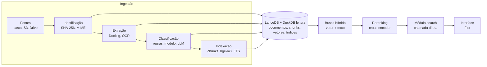

# Proposta: Banco de Documentos para Pesquisa Semântica em Python

29/10/2026 · André Queiroz

## Resumo

A proposta usa o LanceDB como armazenamento único: um diretório local com tabelas de documentos, chunks, rótulos e classificações, onde ficam texto, metadados, vetores e índices. O LanceDB faz a busca vetorial, a full-text e a fusão das duas; o DuckDB, pela extensão `lance`, lê as mesmas tabelas em SQL para facetas, relatórios e análises do catálogo. Em volta, um pipeline em Python faz a extração (Docling) e o enriquecimento (embeddings multilíngues e classificação), e um aplicativo Flet chama a busca diretamente como função Python, sem API intermediária.

Os quatro objetivos viram quatro responsabilidades do sistema:

| Objetivo | O que o sistema faz | Resultado guardado |
| --- | --- | --- |
| Identificar | Varre as fontes, calcula hash SHA-256 e detecta duplicatas e versões | Um ID estável por documento, sem cópias repetidas |
| Catalogar | Extrai metadados técnicos e descritivos (título, autor, datas, idioma, páginas) | Uma ficha por documento na tabela `documents` |
| Classificar | Atribui tipo, tema e tags por regras, modelo zero-shot ou LLM | Rótulos com origem e confiança na tabela `classifications` |
| Indexar | Divide em trechos (chunks), gera embeddings e índices de texto | Índices vetorial, full-text e escalares no LanceDB |

A escolha privilegia simplicidade operacional e licenças livres: tudo fica num diretório local, sem servidor; busca híbrida, filtros por metadados e reranking vêm prontos no LanceDB; e o DuckDB lê as mesmas tabelas para relatórios, sem cópia de dados nem arquivo próprio para travar.

## Arquitetura



Na linha de cima, cada documento passa por cinco etapas e todas gravam no mesmo banco; na de baixo, a busca consulta esse banco e devolve trechos já reordenados, com a fonte para citação.

## Stack recomendada

Todas as peças são open source com licenças permissivas (LanceDB sob Apache 2.0, DuckDB sob MIT) e rodam localmente, sem servidor. A extensão `lance` virou extensão core do DuckDB em 2026 e permite consultar, juntar e agregar tabelas Lance com SQL comum ([LanceDB × DuckDB](https://www.lancedb.com/blog/make-your-sql-workflows-multimodal-with-lancedb-x-duckdb)).

| Etapa | Ferramenta principal | Alternativas | Por quê |
| --- | --- | --- | --- |
| Varredura de fontes | `pathlib` + `watchdog` | `fsspec` (S3, Drive, SFTP) | Mesma API para pasta local e nuvem; `watchdog` detecta arquivos novos |
| Identificação | `hashlib` (SHA-256) + `python-magic` | `datasketch` (MinHash) para quase-duplicatas | Hash detecta cópias exatas e serve de chave do documento |
| Extração de texto | Docling | Unstructured, PyMuPDF, `pypdf` | Lê PDF, DOCX, PPTX, HTML e imagens, preserva títulos e tabelas e exporta Markdown |
| OCR | Docling (EasyOCR/Tesseract) | `ocrmypdf` | Para PDFs escaneados |
| Metadados | Docling + `langdetect` / `lingua` | `exiftool` via `pyexiftool` | Título, autor, datas, idioma |
| Classificação | Regras + `transformers` zero-shot ou LLM com Pydantic | SetFit (poucos exemplos rotulados), BERTopic (descoberta de temas) | Começa sem dados rotulados e evolui |
| Chunking | `semantic-text-splitter` ou chunker do Docling | LangChain / LlamaIndex splitters | Divide respeitando a estrutura do documento |
| Embeddings | `sentence-transformers` com BAAI/bge-m3 | intfloat/multilingual-e5-large, API de embeddings | Multilíngue, bom em português, gera vetor de 1024 dimensões |
| Armazenamento | LanceDB (formato Lance) | SQLite + extensão vetorial, Qdrant | Tabelas colunares num diretório, com vetores, texto, metadados e índices juntos |
| Busca vetorial | Busca exata; índice ANN do LanceDB quando o acervo crescer | — | Sem índice até algumas dezenas de milhares de chunks; depois IVF-PQ ou HNSW |
| Busca textual | FTS nativo do LanceDB | Tantivy | BM25 com filtros, sem servidor |
| Busca híbrida e reranking | `query_type="hybrid"` + `CrossEncoderReranker` (bge-reranker-v2-m3) | `RRFReranker` (padrão, mais rápido) | Fusão das duas buscas e reordenação numa só chamada |
| SQL analítico | DuckDB + extensão `lance` | Polars | Facetas, relatórios e auditoria do catálogo sobre as tabelas Lance |
| Esquema e dados em memória | PyArrow | Pandas, Polars | Esquema tipado das tabelas Lance |
| Orquestração | Prefect | Dagster, Celery, ou só um CLI com Typer | Reprocessamento, retentativas e agendamento |
| Serviço de busca | Módulo Python `search` chamado pela interface | — | Sem servidor nem rede: a interface importa e chama `buscar()` |
| Interface | Flet 1.0 | Shiny for Python, Streamlit | App desktop, web ou mobile em Python puro, com handlers assíncronos |

O LanceDB escala de milhares a milhões de chunks trocando a busca exata por um índice ANN, sem mudar o código da busca, e o mesmo diretório pode ir para S3 ou outro object store se o acervo crescer além de uma máquina.

## Modelo de dados

O acervo é um diretório LanceDB com cinco tabelas. O SHA-256 do arquivo é a chave do documento: o Lance não gera IDs automáticos, e o hash já é estável e único. Os metadados usados como filtro (título, caminho, tipo, temas, idioma, ano) são copiados para cada chunk, porque a busca roda numa tabela só, sem joins.

| Tabela | Papel | Campos principais |
| --- | --- | --- |
| `sources` | De onde vêm os arquivos | `id`, `kind` (pasta, S3, Drive), `uri`, `last_scan_at` |
| `documents` | Ficha catalográfica | `id` (SHA-256), `source_id`, `path`, `mime_type`, `title`, `author`, `language`, `pages`, `created_at`, `modified_at`, `status`, `tipo`, `temas`, `version_of`, `embed_model`, `extra` (JSON em texto) |
| `chunks` | Trechos indexados | `id` (`sha256:ordinal`), `document_id`, `ordinal`, `heading_path`, `page`, `text`, `vector` (float32 × 1024) + cópia de `title`, `path`, `tipo`, `temas`, `language`, `year` |
| `labels` | Vocabulário controlado | `id`, `scheme` (tipo, tema, setor), `name`, `parent_id` |
| `classifications` | Rótulo atribuído | `document_id`, `label_id`, `method` (regra, modelo, LLM, humano), `confidence`, `created_at` |

Esquema em PyArrow e índices (`db.py`):

```python
from datetime import timedelta

import lancedb
import pyarrow as pa

CAMINHO_ACERVO = "data/acervo"
DIM = 1024

documents_schema = pa.schema([
    pa.field("id", pa.string()),                 # SHA-256 do arquivo
    pa.field("source_id", pa.string()),
    pa.field("path", pa.string()),
    pa.field("mime_type", pa.string()),
    pa.field("title", pa.string()),
    pa.field("author", pa.string()),
    pa.field("language", pa.string()),
    pa.field("pages", pa.int32()),
    pa.field("created_at", pa.timestamp("s")),
    pa.field("modified_at", pa.timestamp("s")),
    pa.field("status", pa.string()),             # pending | extracted | indexed | error
    pa.field("tipo", pa.string()),
    pa.field("temas", pa.list_(pa.string())),
    pa.field("version_of", pa.string()),
    pa.field("embed_model", pa.string()),
    pa.field("extra", pa.string()),              # JSON
])

chunks_schema = pa.schema([
    pa.field("id", pa.string()),                 # f"{sha256}:{ordinal}"
    pa.field("document_id", pa.string()),
    pa.field("ordinal", pa.int32()),
    pa.field("heading_path", pa.string()),
    pa.field("page", pa.int32()),
    pa.field("text", pa.string()),
    pa.field("vector", pa.list_(pa.float32(), DIM)),
    # cópia dos metadados do documento, para filtrar na busca
    pa.field("title", pa.string()),
    pa.field("path", pa.string()),
    pa.field("tipo", pa.string()),
    pa.field("temas", pa.list_(pa.string())),
    pa.field("language", pa.string()),
    pa.field("year", pa.int32()),
])

def abrir_acervo(consistencia_s: int = 5):
    # read_consistency_interval faz o app enxergar o que o pipeline gravar depois
    return lancedb.connect(
        CAMINHO_ACERVO, read_consistency_interval=timedelta(seconds=consistencia_s)
    )

def criar_tabelas(db):
    db.create_table("documents", schema=documents_schema, exist_ok=True)
    db.create_table("chunks", schema=chunks_schema, exist_ok=True)

def criar_indices(db, com_ann: bool = False):
    chunks = db.open_table("chunks")
    chunks.create_fts_index(
        "text", language="Portuguese", stem=True,
        remove_stop_words=True, ascii_folding=True, replace=True,
    )
    chunks.create_scalar_index("document_id")                      # BTREE
    chunks.create_scalar_index("tipo", index_type="BITMAP")
    chunks.create_scalar_index("language", index_type="BITMAP")
    chunks.create_scalar_index("temas", index_type="LABEL_LIST")
    if com_ann:  # só depois de algumas dezenas de milhares de chunks
        chunks.create_index(
            metric="cosine", vector_column_name="vector", index_type="IVF_HNSW_SQ"
        )
```

O campo `status` permite reprocessar só o que falhou, e o SHA-256 como chave impede que a mesma cópia entre duas vezes. Como os metadados de filtro estão duplicados nos chunks, toda mudança de classificação atualiza as duas tabelas na mesma etapa. O Lance não tem transação entre tabelas: as etapas gravam com `merge_insert` pela chave, então repetir uma etapa interrompida não duplica nada. Cada escrita cria uma versão da tabela, útil para comparar ao trocar o modelo de embedding (registrado em `embed_model`). Os parâmetros do FTS em português (stemming, stop words, remoção de acentos) devem ser conferidos na versão do LanceDB instalada.

## Etapas do pipeline

Cada etapa lê documentos num `status` e grava o próximo, então o pipeline pode parar e retomar em qualquer ponto.

1. **Identificação.** Varrer as fontes, calcular o SHA-256 de cada arquivo e o MIME real com `python-magic`.
   - Hash já existe em `documents`: ignorar (cópia exata) ou registrar só o novo caminho.
   - Mesmo caminho com hash diferente: nova versão, ligada por `version_of`.
   - Quase-duplicatas (mesmo texto, formatação diferente): MinHash com `datasketch` sobre o texto extraído.
2. **Extração.** Converter com Docling para Markdown estruturado, preservando títulos, tabelas e número de página; ativar OCR só quando o PDF não tiver camada de texto.
3. **Catalogação.** Preencher a ficha: título (metadado do arquivo ou primeiro título do texto), autor, datas, idioma (`lingua`), páginas; o que não tiver coluna própria vai para `extra` em JSON. Gravar com `merge_insert` pelo `id`.
4. **Classificação**, em três camadas que se somam:
   - Regras determinísticas: pasta de origem, extensão, padrões no nome (ex.: "contrato", "ata").
   - Modelo: zero-shot multilíngue sobre um vocabulário controlado em `labels`; quando houver uns 10 exemplos por classe, treinar um SetFit.
   - LLM com saída estruturada (Pydantic) para resumo, palavras-chave e casos ambíguos.
   - Cada rótulo vai para `classifications` com `method` e `confidence`; abaixo de um limite, vai para revisão humana. O rótulo final é resumido em `tipo` e `temas` no documento e copiado para os chunks dele com `table.update`. Para descobrir temas que você ainda não conhece, rode BERTopic sobre os embeddings.
5. **Chunking.** Dividir por seção do documento e depois por tamanho (cerca de 300 a 500 tokens, com 10 a 15% de sobreposição); guardar o caminho de títulos (`heading_path`) e a página de cada trecho, porque isso melhora a busca e permite citar a origem.
6. **Embeddings.** Gerar em lote com `sentence-transformers` (bge-m3), normalizados, e gravar na coluna `vector` junto com os metadados do documento, por `merge_insert` pelo `id` do chunk; prefixar o trecho com título do documento e seção dá mais contexto ao vetor.
7. **Indexação.** Criar uma vez o FTS em português e os índices escalares (BTREE em `document_id`, BITMAP em `tipo` e `language`, LABEL\_LIST em `temas`). O índice vetorial ANN só compensa depois de algumas dezenas de milhares de chunks; antes disso a busca exata é rápida. Ao fim de cada lote, rodar `optimize()`: ele compacta os fragmentos, inclui as linhas novas nos índices e apaga versões antigas.

## Busca semântica

A busca híbrida é nativa do LanceDB: ele roda a busca vetorial e a full-text, junta os resultados e os reordena com o reranker escolhido; sem reranker explícito, usa RRF ([documentação](https://docs.lancedb.com/search/hybrid-search/)). Isso cobre tanto perguntas em linguagem natural quanto termos exatos, como siglas e números de processo, que a busca puramente vetorial costuma perder.

1. Gerar o embedding da pergunta com o mesmo modelo dos chunks.
2. Rodar a consulta híbrida na tabela `chunks`, com filtros por metadados (tipo, tema, idioma, ano) aplicados antes da busca (`prefilter`).
3. Reordenar a união das duas listas com o `CrossEncoderReranker` (bge-reranker-v2-m3).
4. Devolver os 10 melhores com título, caminho, página e trecho, que já vêm na própria linha do chunk.

Consulta híbrida com filtro e reranking:

```python
resultados = (
    chunks.search(query_type="hybrid", vector_column_name="vector", fts_columns="text")
    .vector(qvec)
    .text(pergunta)
    .where("tipo = 'contrato' AND year >= 2020", prefilter=True)
    .rerank(CrossEncoderReranker(model_name="BAAI/bge-reranker-v2-m3"))
    .limit(10)
    .to_list()
)
```

O filtro do `where` é uma expressão SQL em texto: monte-o a partir de valores conhecidos (o vocabulário de `labels`) e escape aspas em qualquer valor digitado. Se o cross-encoder ficar lento em CPU, troque por `RRFReranker()`, que só funde as listas pela posição e responde quase instantaneamente.

Não há API de rede: a busca é um módulo Python (`search/service.py`) com três funções que a interface importa e chama diretamente: `buscar(pergunta, filtros)` e `obter_documento(id)` leem do LanceDB, e `facetas()` usa o DuckDB para contar documentos por tipo, tema e ano e montar os filtros. Se a ferramenta tiver respostas geradas (RAG), os chunks devolvidos já trazem documento e página para citar a fonte.

## Esboço de código

O projeto é um único pacote Python: o pipeline grava no diretório LanceDB, e a interface Flet importa o módulo de busca, que lê do LanceDB e usa o DuckDB para facetas e relatórios.

```text
docsearch/
├── pyproject.toml
├── data/acervo/              # diretório LanceDB (tabelas .lance)
└── src/docsearch/
    ├── config.py             # pydantic-settings
    ├── db.py                 # esquemas PyArrow, conexão e índices
    ├── repo.py               # gravações com merge_insert e optimize
    ├── ingest/
    │   ├── scan.py           # identificação e hash
    │   ├── extract.py        # Docling
    │   ├── catalog.py        # metadados e idioma
    │   ├── classify.py       # regras, zero-shot, LLM
    │   ├── chunk.py
    │   └── embed.py
    ├── search/
    │   └── service.py        # buscar(), obter_documento(), facetas()
    ├── ui/
    │   └── app.py            # interface Flet
    └── cli.py                # Typer: scan, index, optimize, search
```

Gravações idempotentes e manutenção (`repo.py`):

```python
from datetime import timedelta

import pyarrow as pa

from docsearch.db import chunks_schema, documents_schema

def _upsert(tabela, linhas: list[dict], schema: pa.Schema):
    (tabela.merge_insert("id")
        .when_matched_update_all()
        .when_not_matched_insert_all()
        .execute(pa.Table.from_pylist(linhas, schema=schema)))

def gravar_documentos(db, linhas: list[dict]):
    _upsert(db.open_table("documents"), linhas, documents_schema)

def gravar_chunks(db, linhas: list[dict]):
    _upsert(db.open_table("chunks"), linhas, chunks_schema)

def aplicar_classificacao(db, doc_id: str, tipo: str, temas: list[str]):
    filtro = f"id = '{doc_id}'"
    db.open_table("documents").update(where=filtro, values={"tipo": tipo, "temas": temas})
    db.open_table("chunks").update(
        where=f"document_id = '{doc_id}'", values={"tipo": tipo, "temas": temas}
    )

def otimizar(db):
    for nome in ("documents", "chunks"):
        db.open_table(nome).optimize(cleanup_older_than=timedelta(days=7))
```

Identificação e extração de um arquivo:

```python
import hashlib
from pathlib import Path

import magic
from docling.document_converter import DocumentConverter

converter = DocumentConverter()

def sha256(path: Path) -> str:
    h = hashlib.sha256()
    with path.open("rb") as f:
        for bloco in iter(lambda: f.read(1 << 20), b""):
            h.update(bloco)
    return h.hexdigest()

def identificar(path: Path) -> dict:
    return {
        "path": str(path),
        "sha256": sha256(path),
        "mime_type": magic.from_file(str(path), mime=True),
    }

def extrair(path: Path) -> str:
    resultado = converter.convert(str(path))
    return resultado.document.export_to_markdown()
```

Embeddings em lote:

```python
from sentence_transformers import SentenceTransformer

modelo = SentenceTransformer("BAAI/bge-m3")

def embed(textos: list[str]) -> list[list[float]]:
    return modelo.encode(textos, batch_size=32, normalize_embeddings=True).tolist()
```

Instalação: `pip install lancedb duckdb pyarrow sentence-transformers flet`. A extensão `lance` do DuckDB é baixada no primeiro `INSTALL lance`; para distribuir o app sem depender de internet na primeira execução, instale a extensão durante a build. O `doc_id` é sempre um SHA-256 gerado pelo próprio pipeline, por isso pode entrar direto no filtro.

Serviço de busca chamado diretamente pela interface. Modelos e conexões são abertos uma vez, na importação; o DuckDB roda em memória, só lendo as tabelas Lance, e cada chamada usa um cursor próprio para ser segura entre threads:

```python
# search/service.py
from dataclasses import dataclass

import duckdb
from lancedb.rerankers import CrossEncoderReranker
from sentence_transformers import SentenceTransformer

from docsearch.db import CAMINHO_ACERVO, abrir_acervo

_modelo = SentenceTransformer("BAAI/bge-m3")
_reranker = CrossEncoderReranker(model_name="BAAI/bge-reranker-v2-m3")
_db = abrir_acervo()
_chunks = _db.open_table("chunks")
_documents = _db.open_table("documents")

_duck = duckdb.connect()  # em memória: nenhum arquivo para travar
_duck.execute("INSTALL lance; LOAD lance;")
_duck.execute(f"ATTACH '{CAMINHO_ACERVO}' AS acervo (TYPE LANCE)")

@dataclass
class Resultado:
    titulo: str
    caminho: str
    pagina: int | None
    trecho: str
    score: float

def _sql_str(valor: str) -> str:
    return "'" + valor.replace("'", "''") + "'"

def buscar(pergunta: str, k: int = 10, tipo: str | None = None) -> list[Resultado]:
    qvec = _modelo.encode(pergunta, normalize_embeddings=True)
    consulta = (
        _chunks.search(query_type="hybrid", vector_column_name="vector", fts_columns="text")
        .vector(qvec)
        .text(pergunta)
    )
    if tipo:
        consulta = consulta.where(f"tipo = {_sql_str(tipo)}", prefilter=True)
    linhas = consulta.rerank(_reranker).limit(k).to_list()
    return [
        Resultado(l["title"] or l["path"], l["path"], l["page"], l["text"], l["_relevance_score"])
        for l in linhas
    ]

def obter_documento(doc_id: str) -> dict | None:
    linhas = _documents.search().where(f"id = {_sql_str(doc_id)}").limit(1).to_list()
    return linhas[0] if linhas else None

def facetas() -> dict[str, list[tuple]]:
    cur = _duck.cursor()
    return {
        "tipo": cur.sql(
            "SELECT tipo, count(*) FROM acervo.main.documents GROUP BY tipo ORDER BY 2 DESC"
        ).fetchall(),
        "tema": cur.sql(
            "SELECT tema, count(*) FROM (SELECT unnest(temas) AS tema FROM acervo.main.documents) "
            "GROUP BY tema ORDER BY 2 DESC"
        ).fetchall(),
        "ano": cur.sql(
            "SELECT year(created_at) AS ano, count(*) FROM acervo.main.documents "
            "GROUP BY ano ORDER BY ano"
        ).fetchall(),
    }
```

Interface em Flet 1.0. A busca roda numa thread com `asyncio.to_thread` para a janela não travar enquanto os modelos trabalham:

```python
# ui/app.py
import asyncio
from pathlib import Path

import flet as ft

from docsearch.search.service import buscar

def main(page: ft.Page):
    page.title = "Busca de documentos"
    consulta = ft.TextField(label="Pergunte ou digite termos", expand=True, autofocus=True)
    progresso = ft.ProgressRing(visible=False)
    resultados = ft.ListView(expand=True, spacing=4)

    async def abrir(e):
        await ft.UrlLauncher().launch_url(Path(e.control.data).resolve().as_uri())

    async def pesquisar(e):
        texto = (consulta.value or "").strip()
        if not texto:
            return
        progresso.visible = True
        resultados.controls.clear()
        page.update()
        itens = await asyncio.to_thread(buscar, texto)
        for r in itens:
            resultados.controls.append(ft.ListTile(
                title=ft.Text(r.titulo),
                subtitle=ft.Text(f"p. {r.pagina or '-'} · {r.trecho[:200]}…"),
                data=r.caminho,
                on_click=abrir,
            ))
        progresso.visible = False
        page.update()

    consulta.on_submit = pesquisar
    page.add(
        ft.Row([consulta, ft.Button("Buscar", on_click=pesquisar), progresso]),
        resultados,
    )

ft.run(main)
```

Como o carregamento dos modelos leva alguns segundos, mostre uma tela de espera na abertura do app ou importe o serviço numa thread em segundo plano. O mesmo app roda como janela desktop (`flet run`) ou é empacotado com `flet build` ([Flet 1.0](https://flet.dev/docs/updates/breaking-changes/v1-0-0/removed-deprecated-apis)).

## Roteiro e riscos

O caminho mais seguro é ter busca funcionando ponta a ponta já na primeira fase, com uma amostra pequena, e só então sofisticar classificação e qualidade.

1. **MVP:** diretório LanceDB com `documents` e `chunks`, varredura de uma pasta, Docling, chunking simples, bge-m3 e busca só vetorial pelo CLI.
2. **Catálogo:** fichas completas, deduplicação, versões, FTS e índices escalares, busca híbrida nativa e o módulo `search/service.py`.
3. **Classificação:** vocabulário em `labels`, regras + zero-shot, fila de revisão humana, cópia de `tipo` e `temas` para os chunks e facetas pelo DuckDB.
4. **Qualidade:** reranker, conjunto de avaliação com 30 a 50 perguntas reais e métricas (recall@10, MRR), comparação do índice ANN com a busca exata, `optimize()` agendado, orquestração com Prefect.
5. **Interface:** app Flet com campo de busca, filtros por faceta, lista de resultados e ficha do documento.

| Risco | Mitigação |
| --- | --- |
| Sem transação entre tabelas do Lance | Campo `status` e gravações com `merge_insert` pela chave, que podem ser repetidas sem duplicar |
| Metadados copiados nos chunks ficam desatualizados | Atualizar `documents` e `chunks` na mesma função ao mudar a classificação |
| Muitas escritas pequenas fragmentam as tabelas | `optimize()` ao fim de cada lote, com limpeza de versões antigas |
| App não enxerga o que o pipeline acabou de gravar | Conectar com `read_consistency_interval` |
| Stemming em português do FTS pode variar por versão | Testar na versão instalada; a busca semântica cobre variações de forma |
| Extensão `lance` do DuckDB baixada na primeira execução | Instalá-la durante a build do app |
| PDFs escaneados ou mal formatados geram texto ruim | OCR só onde falta texto; marcar `status = error` e revisar |
| Trocar o modelo de embedding invalida o índice | Registrar em `embed_model`; gerar nova coluna ou tabela e comparar versões antes de trocar |
| Busca vetorial erra siglas e códigos exatos | Busca híbrida com FTS |
| Classificação automática com rótulos errados | Guardar `confidence` e `method`; revisão humana abaixo do limite |
| Documentos sigilosos expostos na busca | Coluna de permissão por chunk e filtro obrigatório no `where` |
| Embeddings lentos em CPU | Processar em lote, em segundo plano, ou usar GPU ou API |

Perguntas em aberto que mudam a proposta: quantos documentos e de quais formatos, se ficam em pasta local ou na nuvem, se há GPU disponível e se a busca terá controle de acesso por usuário.
